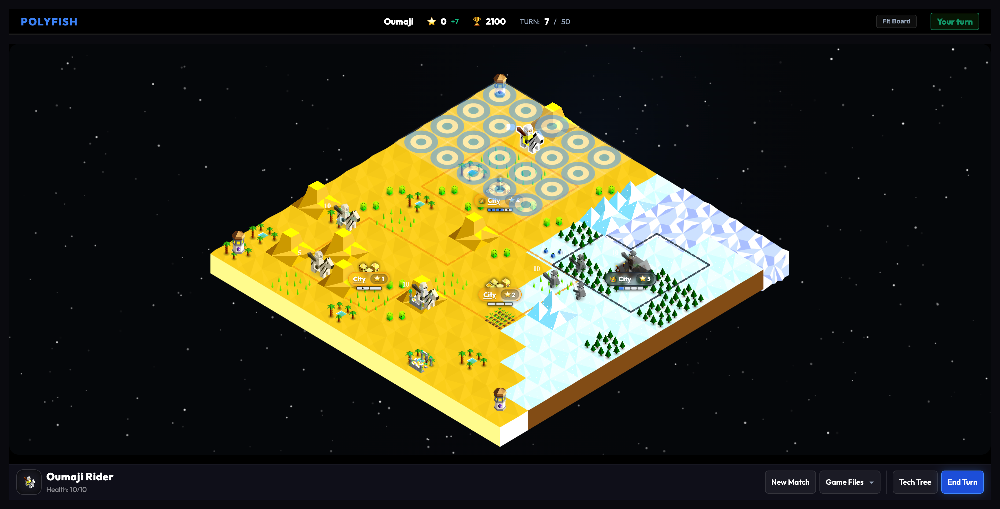

# Polyfish

Polyfish is an open-source Rust game engine for *The Battle of Polytopia*. Fork it to use the game rules, map generation, and fog-of-war observations as the environment for your own bots and training pipelines. The engine runs headlessly without a model checkpoint, and the browser simulator lets you play and inspect matches.

The repository also includes model-free opponents, MCTS agents, and toolkits for self-play, neural-network training, and head-to-head evaluation.



## Use the Rust engine

The `polyfish` crate lives in [`polyfish-rs/`](polyfish-rs/). To use it from another Rust project, clone or fork this repo and add the crate as a Cargo path dependency. For sibling checkouts, add this to your `Cargo.toml`.

```toml
[dependencies]
polyfish = { path = "../Polyfish/polyfish-rs" }
```

Create a seeded match, give your policy the acting player's observation and legal actions, and pass its choice back to the engine for validation and application. The API also supports simulation and undo for search, as well as saves and replays for reproducing matches. [Rust simulator API and agent example](research/simulator-api.md)

The model-free simulator supports **1v1 Might with fog of war**, all **12 regular tribes**, and boards of **121, 196, 256, 324, 400, and 900 tiles**. The supported map types are Drylands, Lakes, Continents, Pangea, Archipelago, and Water World. [Simulator guide](research/README.md)

## Run a match

### Headless

From the repository root, run a seeded match between two built-in opponents. The command prints a JSON result.

```sh
cargo run --manifest-path polyfish-rs/Cargo.toml --locked --release --bin research_match -- \
  --map-type drylands --map-size 121 --tribe1 imperius --tribe2 bardur --seed 42 \
  --preset1 easy --preset2 normal --max-turns 20
```

Add `--replay polyfish-match.json` to save a replay you can open in the browser simulator. [Headless match options](research/README.md#play-locally)

### Browser

From the repository root, start the Rust server and open the simulator. A full checkout serves the graphical board directly. [Open the local simulator](http://127.0.0.1:3000/simulator/)

```sh
cd polyfish-rs
POLYFISH_LISTEN=127.0.0.1:3000 cargo run --locked --release --bin polyfish
```

Easy, Normal, and Expert are available without a checkpoint. To use the learned opponent on 121-tile Drylands, place a compatible `model.safetensors` in `polyfish-rs/`. At startup, the server looks for `live_game.json`, `saved_state.json`, or the newest `replays/mod_replay_*.json` in that directory before generating a map.

## AI and training toolkits

- **Model-free opponents.** Easy, Normal, and Expert are built-in baselines for browser and headless matches. The crate also includes a heuristic MCTS agent. [Opponent presets](research/README.md#play-locally) · [Heuristic MCTS](polyfish-rs/src/ai/heuristic_mcts.rs)
- **Neural self-play and training.** The bundled AlphaZero-style pipeline uses Rust Gumbel MCTS to generate self-play data and PyTorch to train `model.safetensors`. Its current features and checkpoints use 11×11 boards. The self-play CLI supports preset, checkpoint, and anchor opponents. [Self-play binary](polyfish-rs/src/bin/self_play.rs) · [Training driver](polyfish-rs/run_training_loop.sh) · [PyTorch trainer](polyfish-rs/train.py)
- **Evaluation and monitoring.** Run checkpoint matches with `arena`, track strength against frozen Elo anchors with `ladder.py` and `elo.py`, and view loss, move mix, and value distribution in the training dashboard. [Arena](polyfish-rs/src/bin/arena.rs) · [Strength ladder](polyfish-rs/ladder.py) · [Local training dashboard](http://127.0.0.1:3000/simulator/training.html)

For the bundled neural pipeline on macOS or Linux, install Rust and Python 3 and run these commands from the repository root. The training driver initializes the model, generates `games_*.safetensors`, updates the checkpoint, and periodically runs an arena strength check.

```sh
cd polyfish-rs
./local_setup.sh
./run_training_loop.sh
```

For GPU setup, see the remote and Vast.ai scripts. The launch and reporting tools also include a Windows training driver. [Remote setup](polyfish-rs/remote_setup.sh) · [Vast.ai setup](polyfish-rs/vast_setup.sh) · [Windows launcher](scripts/run-training.bat)

## Repository guide

- [`polyfish-rs/`](polyfish-rs/) contains the game engine, web server, agents, and training binaries. The contributor guide covers engine invariants, checkpoint compatibility, and verification commands. [Contributor guide](AGENTS.md)
- [`src/public/`](src/public/) contains the primary graphical simulator. [`polyfish-ui/`](polyfish-ui/) contains the Vite frontend and the plain research board.
- [`research/`](research/) contains the simulator quickstart, benchmark fixtures and reproduction commands, and paper draft. [Paper draft](research/PAPER.md)
- [`polyfish-mod/`](polyfish-mod/) contains the Steam replay capture mod. [`polyfish-scraper/`](polyfish-scraper/) contains game data utilities.

## Research and training records

- Training pipeline work and experiments. [Pipeline audit](docs/experiments/expert_pipeline_audit.md) · [Registered experiments and results](docs/experiments/hypothesis_driven_improvements.md)
- Search, learning signals, and throughput. [Expert review](docs/experiments/expert_review.md) · [Throughput investigation](docs/experiments/expert_boost_throughput.md)
- Engine architecture, branching factor, and observation memory. [Engine notes](docs/notes/notes.md) · [Heuristics](docs/notes/notes-heuristics.md) · [Memory](docs/notes/notes-memory.md)

[Open an issue](https://github.com/HenBOMB/Polyfish/issues)
