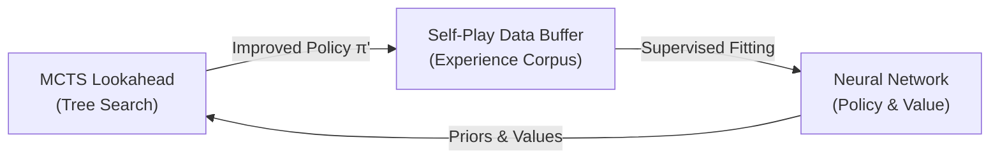

# Architectural Synthesis: The MCTS Opponent Modeling Dependency & The Self-Play Path

This document explains why attempting to hand-code complex tactical heuristics in `scoring.rs` is an expert-systems trap, why true Reinforcement Learning (Option 2) fundamentally depends on Adversarial MCTS (Option 1), and the technical roadmap for fixing in-tree opponent modeling.

---

## 1. Why Handcoding Heuristics is an Expert-Systems Trap

When observing tactical vulnerabilities during evaluation, the immediate temptation is often to add specialized heuristic rules to `scoring.rs`:
- Patching specific garrison bonuses.
- Handcoding proximity threat penalties.
- Hardcoding unit-specific combat trades.

### The Inherent Flaw
*The Battle of Polytopia* possesses high combinatorial complexity across terrain, movement tech (Roads, Navigation), special unit abilities (Dash, Escape, Infiltration, Freeze, Explode), and asymmetric tribe economies.
- Hand-crafting heuristics creates brittle rule systems that inevitably contradict each other, produce unintended side effects, and fail against novel tactical lines.
- **The Core ML Principle**: The heuristic teacher's purpose was strictly to solve the **cold-start problem** (providing a fast warm start so training does not begin from random uniform noise). Trying to manually program grandmaster tactical intuition into the heuristic teacher defeats the purpose of an AlphaZero learning architecture.

---

## 2. Why Option 2 (Self-Play RL) Depends on Option 1 (Adversarial MCTS)

In the AlphaZero paradigm, self-play and training operate in a closed feedback loop:

### The Solitaire Failure Mode
If the MCTS engine operates in **solitaire mode** (`adversarial_search: false`):
1. **Search Deletes Opponent Responses**: The search tree explores multi-step lines assuming the opponent executes zero moves.
2. **Polluted Policy Target ($\pi'$)**: Moves that leave units exposed or overextended receive high visit counts because the tree never simulates the opponent punishing them.
3. **Flawed Value Target ($z$)**: The neural network learns value representations based on optimistic solitaire assumptions rather than adversarial reality.
4. **Self-Play Stagnation**: Training against flawed search targets causes self-play to plateau or develop blind spots—the exact failure mode observed in legacy checkpoints like `iter 156`.

**Conclusion**: Self-play RL (Option 2) cannot produce robust play if the search engine generating its training targets cannot simulate the opponent. **Fixing MCTS opponent modeling (Option 1) is a prerequisite for Option 2.**

---

## 3. How to Fix Option 1: Adversarial MCTS Architecture

To enable genuine adversarial lookahead, the search engine must realistically model the opponent during in-tree rollouts. The codebase already possesses foundational work (commit `88f70422`), but key architectural components must be aligned:

### 3.1 Belief-State In-Tree Opponent Modeling
Under Fog of War (FOW), the root player cannot see through the fog. Therefore, an in-tree opponent cannot play with global knowledge without cheating.
- **Current Foundation**: [`clone_for_mcts(pov)`](file:///mnt/hen480/henry/Escritorio/Coding/PolyAI/polyfish-rs/src/game.rs#L345) constructs a belief-state projection containing only information revealed to the root player.
- **Turn Handover**: When `adversarial_search` is active, `simulate_move(EndTurn)` switches `current_player_turn_id` to the opponent instead of deleting the turn.

### 3.2 In-Tree Opponent Policy Selection
When control hands over to the opponent inside the search tree:
- **Challenge**: What policy drives the opponent's moves within the tree?
  - Option A: **Neural Prior Rollout**: Use the current neural network policy $\pi_\theta$ evaluated from the opponent's perspective.
  - Option B: **Fast Heuristic Simulation**: Use the fast algorithmic policy to simulate the opponent's turn without heavy batched neural evaluation overhead.
  - Option C: **Full Alternating MCTS**: Expand opponent nodes as two-player alternating minimax nodes in the tree.

### 3.3 Root Horizon & Multi-Ply Budget
In-tree turn alternation doubles the depth requirement of the tree:
- A 4-ply search under solitaire mode looks 4 turns ahead for player 1.
- Under adversarial search, 4 plies represent 2 turns for player 1 and 2 turns for player 2.
- The search budget (`mcts_iters`) and `max_turns_ahead` horizon must be calibrated so adversarial search achieves meaningful tactical depth without computational stalling.

---

## 4. Next Phase Action Plan

1. **Verify Adversarial Engine Integrity**: Validate the existing adversarial mechanics in `game.rs` and `mcts_zero.rs`.
2. **Benchmark Search Performance**: Measure node-evaluation throughput and tactical threat detection under adversarial search vs solitaire search.
3. **Transition to Adversarial Self-Play**: Enable adversarial in-tree simulation during self-play data generation to train the network on genuine two-player counter-responses.
